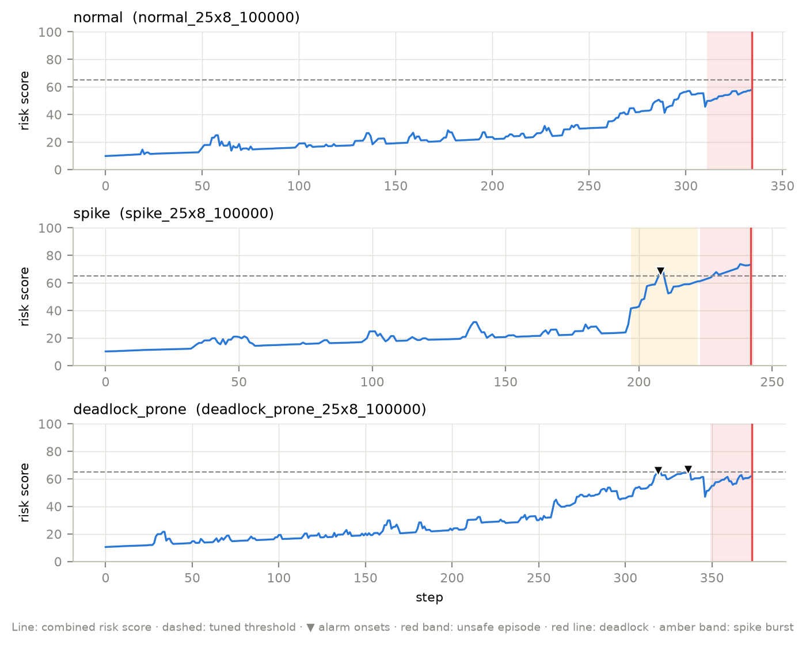
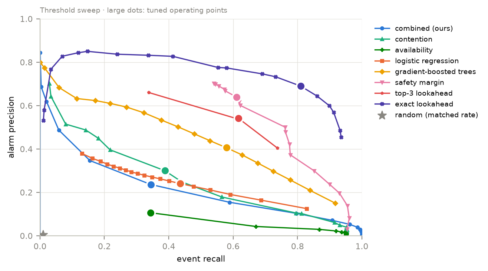
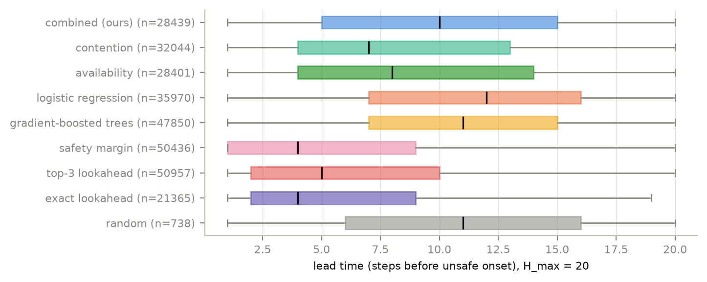
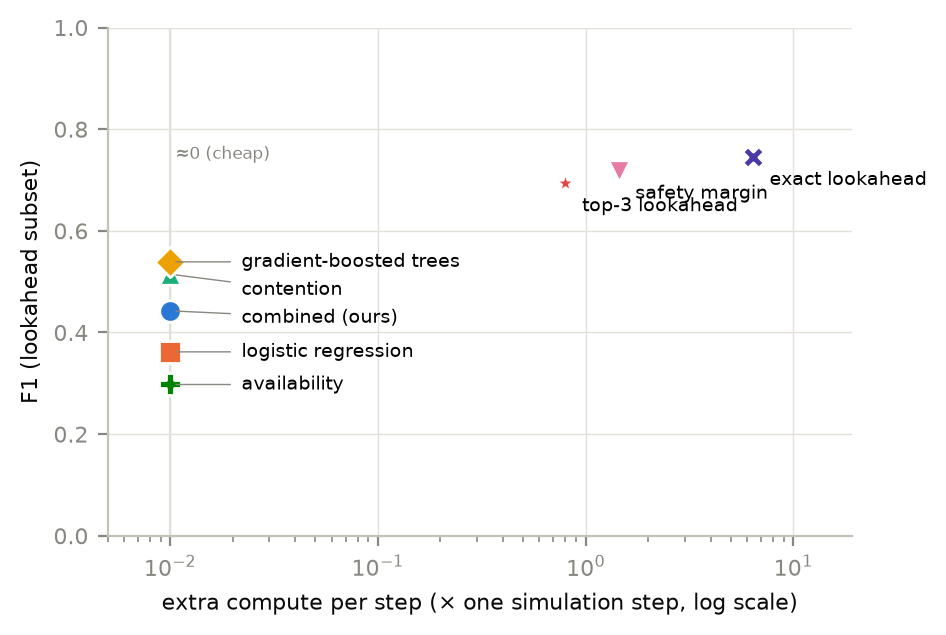
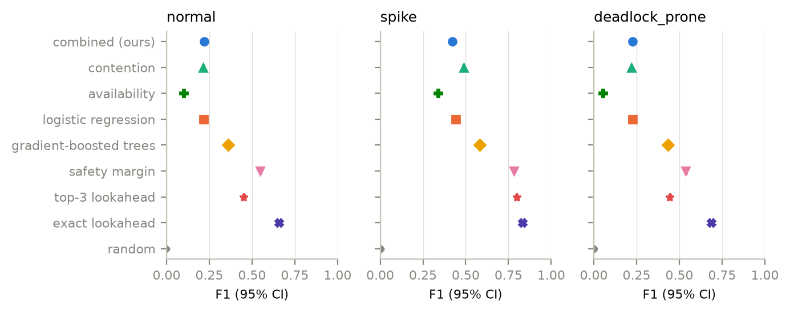
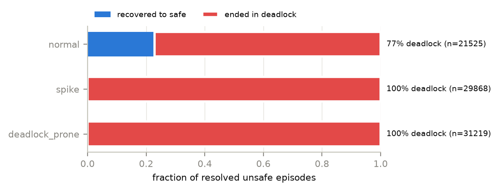
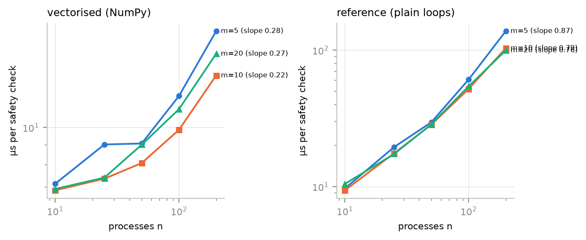

# 1. Summary in one page

**Question.** Banker's algorithm tells an operating system whether the current state is *safe right now*. It does
not warn that the system is *heading towards* danger. We asked: **can simple, explainable signals raise an alarm a
few steps before Banker's algorithm reports an unsafe state — how early, and how reliably?**

**What we built.** A resource-allocation simulator (with Banker's safety check and deadlock detection), three
workload scenarios, a rule-based early-warning algorithm (no machine learning), an evaluation method borrowed from
hospital and earthquake early-warning systems, and an experiment pipeline. Everything is tested by 122 automated
tests.

**How big the experiment was.** 195,000 simulated sequences — 440 million resource requests,
each followed by a Banker's safety check — across 3 scenarios and 5 system sizes
(10 to 200 processes), run on AWS EC2 **c7i.8xlarge** (32 vCPUs, 61.8 GB RAM, region ap-south-2 / Hyderabad).
Settings were tuned on 45,000 sequences and all reported numbers come from a separate
150,000 sequences the tuner never saw.

**Main answers.**

1. **Yes, early warning works — moderately.** Our combined score catches 34% of unsafe onsets
   in advance with 24% of its alarms correct (F1 = 0.28), giving a median
   **10 steps of warning**. Random alarms at the same rate score F1 = 0.01,
   and the simple "free resources are low" rule scores 0.16.
2. **Contention is the single most useful signal** (F1 = 0.34 on its own). Averaging in
   weaker signals dilutes it: the tuner's best combination doubled contention's weight
   ("double_contention").
3. **Machine learning on the same cheap signals helps a lot.** Gradient-boosted trees reached F1 =
   0.48 (vs 0.28 for our rule), while logistic regression gained little
   (0.31): the signals matter *in combination*, in ways a simple weighted sum cannot
   capture. The trade-off is explainability.
4. **Checking the safety boundary directly is most accurate, and does not have to be expensive.** On the runs
   where every method was computed, exact lookahead scored 0.74 but costs 43× a whole
   simulation step at 200 processes; a *safety margin* (how much free resource could disappear before the
   state turns unsafe) scored 0.72 for only about 1.7× the cost. Both warn
   later than the cheap signals.
5. **Sudden bursts are easiest to predict, slow build-ups hardest** (F1 0.42
   for spikes vs 0.22 for normal workloads).
6. **"Unsafe" almost always became "deadlock"** in our model (100% of
   unsafe episodes for spikes, 77% for normal workloads), because
   processes really do end up requesting their full declared claims.

# 2. Background: the ideas in plain words

- **Process:** a running program that holds and requests resources.
- **Resource type:** a kind of resource (memory blocks, a printer, a file lock) with a fixed number of units.
- **Maximum claim:** the most units of each type a process says it may ever need. **Need** = claim − what it holds.
- **Safe state:** Banker's algorithm can find *some order* in which every process could get its full need and finish.
- **Unsafe state:** no such order exists. This is *danger*, not yet necessarily a deadlock.
- **Deadlock:** some waiting processes can never be satisfied even if everyone else finishes. A deadlocked state is
  always unsafe; a safe state is never deadlocked (our tests check this on thousands of random states).

Banker's algorithm is like a fire alarm: it rings when the fire is already there. We are testing a smoke detector.

# 3. What we built

{ width=100% }

## 3.1 The simulator ("observer mode")
In a real system, Banker's algorithm *refuses* dangerous requests, so the system never becomes unsafe — and there
would be nothing to predict. Our simulator therefore **grants every valid request** and uses Banker's algorithm
only to *watch*. Every step:

1. Waiting processes are retried, longest-waiting first; a process whose claim is now fully met finishes and returns
   everything, and the retry repeats with the freed units.
2. One process makes a new request (never zero, never more than its remaining need). If the units are free it is
   granted — **even if this makes the state unsafe** — otherwise the process waits.
3. Finished processes release their resources; in the *normal* scenario a process may also give some back early.
4. We record: is the state unsafe (Banker's)? is it deadlocked (detection)? and the five warning signals.

A run ends at the first deadlock, when every process has finished, or at a step limit.

## 3.2 Three workloads
| Scenario | What happens | What it tests |
|---|---|---|
| normal | small requests, frequent completions, occasional early releases | false alarms; slow build-up |
| spike | normal traffic, then 80% of processes suddenly grab large chunks and hold them | sudden change |
| deadlock_prone | process *i* keeps asking for resource *i+1* (a circular pattern) and rarely finishes | gradual build-up |

The key setting is **claim tightness** (total declared claims ÷ total units). We calibrated it on practice seeds so
each scenario gives a mix of runs that do and do not become unsafe (Section 6.1).

## 3.3 The warning algorithm
After every step we compute five numbers between 0 and 1:

| Signal | Meaning |
|---|---|
| Scarcity | how much of all resources is already handed out |
| Need pressure | how much is still wanted compared with what is free |
| Contention | for how many resource types two or more processes want more than is free |
| Waiting ratio | what fraction of processes are blocked |
| Request rate | whether requests are speeding up compared with the previous 10 steps |

They are combined into a **risk score from 0 to 100**. An alarm fires when the score stays above a threshold for
*k* steps in a row, and then stays quiet for *R* steps so that one long risky stretch counts once. The tuned setting
was threshold **65**, k = 1, R = 10, using
weights "double_contention".

# 4. Every edge case we handle
Each item below has an automated test (122 tests in total).

- **States:** safe-and-deadlocked never happens; unsafe-but-not-deadlocked is recorded separately; a starting state
  that is unsafe is redrawn; all-finished counts as safe and ends the run; units are never created or lost; a finished
  process never holds anything; the fast Banker's check always agrees with the textbook version.
- **Requests:** never zero; never above the remaining need (flagged and skipped if it ever were); above the free
  units → wait; a request that makes the state unsafe is still granted (observer mode); waiting or finished processes
  never request; waiting processes are retried first-come first-served; no possible requester ends the run.
- **Life-cycle:** a process whose need reaches zero finishes and releases everything; unsafe can recover to safe, so
  one run can have several danger episodes; the same seed always gives the same run; a process finishing during the
  retry frees units for the next waiter in the same step (a bug we found and fixed).
- **Signals:** all zero when nothing is active; no division by zero when nothing is free; request rate is zero until
  there is enough history; every signal always stays within 0–1.
- **Alarms:** a score hovering at the threshold needs *k* steps in a row; a long high stretch fires once per quiet
  period; no alarms while the system is already unsafe.
- **Scoring:** an alarm 1–20 steps before danger is a true alarm; an alarm at the same step is a *miss*
  (detection, not prediction); several alarms before one event — the earliest gives the lead time; one alarm cannot
  claim two events; alarms near the end of a run cut off by the step limit are not counted (the future is unknown),
  but near the end of a run that ended in deadlock they count as false (the future is known); danger that flickers
  unsafe→safe→unsafe within 5 steps is one episode; danger in the first 3 steps is excluded for every method.
- **Experiments:** practice (tuning) seeds and test seeds can never mix (checked in code); a crashed run resumes;
  re-running the same configuration is skipped.

# 5. How the experiments were run

1. **Dry run on the MacBook** (48,000 sequences) to check the whole pipeline and measure timings.
2. **Official run on AWS EC2**, the same code and the same command (`run_all.sh`), at larger scale:
- **Instance:** 1 x c7i.8xlarge (32 vCPU, 61 GB RAM), Ubuntu 24.04, region ap-south-2 (Hyderabad)
- **Launched (UTC):** 2026-10-21 05:41
- **Terminated (UTC):** 2026-10-21 11:31
- **Instance hours:** 5.84
- **Pipeline wall time:** 5 h 40 min (incl. a 42-min stall from thread oversubscription, fixed and resumed)
- **Estimated cost:** about $8.39 (compute $8.33 at $1.428/h, 40 GB gp3 disk $0.03, public IPv4 $0.03); paid from AWS credits
- **Code:** commit 328caf6; tuning, evaluation and figures re-run with the learned-score NaN fix of commit 173a323
- **Cost guards:** 10-hour OS stop timer; self-stop 45 min after the pipeline; idle-CPU (<2% for 30 min) stop alarm; SSH from one IP only; all resources tagged and deleted
- **Clean-up audit:** no instances, volumes, Elastic IPs, snapshots, security group, alarm or key pair left (deployment/aws_audit.sh: AUDIT CLEAN)

The pipeline: tests → smoke run → calibration → 45,000 practice runs →
150,000 test runs → tuning (≈2,000 settings tried per method) → evaluation with 95%
confidence intervals → speed study → tables and figures. Every run stores its configuration, code version
(commit `328caf6`) and machine details.

# 6. Results

## 6.1 Setup per cell (test split)
| Scenario | Processes | Resource types | Sequences | Steps | With ≥1 unsafe event | Ended in deadlock | Claim tightness |
|---|---|---|---|---|---|---|---|
| deadlock_prone | 100 | 20 | 10000 | 29793804 | 93% | 93% | 1.48 |
| deadlock_prone | 10 | 5 | 10000 | 1020230 | 41% | 41% | 1.48 |
| deadlock_prone | 200 | 20 | 10000 | 59959348 | 93% | 93% | 1.48 |
| deadlock_prone | 25 | 8 | 10000 | 4036769 | 40% | 40% | 1.48 |
| deadlock_prone | 50 | 10 | 10000 | 9877410 | 45% | 45% | 1.48 |
| normal | 100 | 20 | 10000 | 39280274 | 66% | 63% | 1.43 |
| normal | 10 | 5 | 10000 | 1071547 | 27% | 25% | 1.43 |
| normal | 200 | 20 | 10000 | 82123372 | 56% | 54% | 1.43 |
| normal | 25 | 8 | 10000 | 4494155 | 16% | 14% | 1.43 |
| normal | 50 | 10 | 10000 | 11527074 | 11% | 10% | 1.43 |
| spike | 100 | 20 | 10000 | 27023589 | 62% | 62% | 1.58 |
| spike | 10 | 5 | 10000 | 707662 | 71% | 71% | 1.58 |
| spike | 200 | 20 | 10000 | 56973051 | 53% | 53% | 1.58 |
| spike | 25 | 8 | 10000 | 2939715 | 60% | 60% | 1.58 |
| spike | 50 | 10 | 10000 | 7434425 | 53% | 53% | 1.58 |

## 6.2 Main result — can we warn before "unsafe"? (warning window: 20 steps)
| Method | Precision | Recall | F1 [95% CI] | False alarms / 1000 steps | Median lead (steps) |
|---|---|---|---|---|---|
| Combined score (ours) | 0.24 | 0.34 | 0.28 [0.28–0.28] | 0.33 | 10 |
| Contention | 0.30 | 0.39 | 0.34 [0.34–0.34] | 0.22 | 7 |
| Need pressure | 0.31 | 0.14 | 0.19 [0.19–0.19] | 0.07 | 7 |
| Waiting ratio | 0.24 | 0.26 | 0.25 [0.25–0.25] | 0.31 | 13 |
| Request rate | 0.16 | 0.12 | 0.14 [0.13–0.14] | 0.15 | 9 |
| Availability (free-resource rule) | 0.11 | 0.34 | 0.16 [0.16–0.16] | 0.71 | 8 |
| Logistic regression (ML) | 0.24 | 0.44 | 0.31 [0.31–0.31] | 0.48 | 12 |
| Gradient-boosted trees (ML) | 0.41 | 0.58 | 0.48 [0.47–0.48] | 0.29 | 11 |
| Safety margin | 0.64 | 0.61 | 0.62 [0.62–0.63] | 0.08 | 4 |
| Top-3 lookahead | 0.54 | 0.62 | 0.58 [0.57–0.58] | 0.13 | 5 |
| Exact lookahead (expensive) | 0.69 | 0.81 | 0.74 [0.74–0.75] | 0.62 | 4 |
| Random alarms (chance) | 0.00 | 0.01 | 0.01 [0.01–0.01] | 0.44 | 11 |

{ width=80% }

{ width=85% }

*Precision* = share of alarms that were followed by danger within 20 steps. *Recall* = share of dangers that were
warned about in advance. *F1* combines both. Lookahead is computed on part of the runs (all runs up to 25 processes,
a sample above), so on exactly those runs: lookahead F1 = 0.74, combined = 0.44.

**Reading it:** our score is far better than chance and clearly better than the simple free-resource rule. On
danger events that both caught, it warned earlier than the free-resource rule (11 vs
8 steps median); against lookahead the lead times were similar (5 vs
4 steps over 8,012 shared events).

## 6.3 Which signals matter (ablation)
| Variant | F1 |
|---|---|
| all five indicators, equal weights | 0.24 |
| without scarcity | 0.26 |
| without need pressure | 0.25 |
| without contention | 0.20 |
| without waiting ratio | 0.27 |
| without request rate | 0.22 |

Removing contention or request rate hurts the equal-weight combination most; removing waiting ratio *helps*.
Adding weak signals to a strong one dilutes it, which is why the tuner's best combination doubled contention's
weight.

## 6.4 Machine learning, the safety margin and the cost of being exact
{ width=80% }

| Computation | Processes | × one simulation step |
|---|---|---|
| Safety margin | all | 1.44 |
| Safety margin | 200 | 1.66 |
| Top-3 lookahead | all | 0.80 |
| Top-3 lookahead | 200 | 0.91 |
| Exact lookahead (expensive) | all | 6.40 |
| Exact lookahead (expensive) | 200 | 43.45 |

The learned models and the five signals cost almost nothing per step. The safety margin and top-3 lookahead
use a fixed handful of safety checks, so their cost barely grows with system size, while exact lookahead runs
one check per process and becomes very expensive for large systems.

**Wrong maximum claims.** When the signals were computed from claims that were off by up to ±20%, F1 changed by
less than half a percentage point for every method, so the method does not need perfectly known claims.

| Method | F1, true claims | F1, claims ±20% |
|---|---|---|
| Combined score (ours) | 0.28 | 0.28 |
| Need pressure | 0.19 | 0.19 |
| Contention | 0.34 | 0.34 |
| Combined, max | 0.34 | 0.34 |
| Logistic regression (ML) | 0.31 | 0.31 |
| Gradient-boosted trees (ML) | 0.48 | 0.48 |

## 6.5 By scenario (F1)
| Method | normal | spike | deadlock_prone |
|---|---|---|---|
| Combined score (ours) | 0.22 | 0.42 | 0.23 |
| Contention | 0.21 | 0.49 | 0.22 |
| Need pressure | 0.06 | 0.34 | 0.01 |
| Waiting ratio | 0.29 | 0.03 | 0.31 |
| Request rate | 0.00 | 0.23 | 0.00 |
| Availability (free-resource rule) | 0.10 | 0.34 | 0.05 |
| Logistic regression (ML) | 0.22 | 0.44 | 0.23 |
| Gradient-boosted trees (ML) | 0.36 | 0.58 | 0.43 |
| Safety margin | 0.55 | 0.78 | 0.54 |
| Top-3 lookahead | 0.45 | 0.80 | 0.44 |
| Exact lookahead (expensive) | 0.66 | 0.83 | 0.69 |
| Random alarms (chance) | 0.00 | 0.01 | 0.01 |

{ width=100% }

Spikes are easiest: several signals rise together, and the danger starts a median 26
steps after the burst begins (only 3.0% before it). Slow build-ups give little warning
before the line is crossed; there, waiting ratio alone does better than the combination. Contention's overall lead
comes mainly from spikes.

## 6.6 Unsafe versus deadlock
| Scenario | Recovered | Became deadlock | Deadlock share |
|---|---|---|---|
| deadlock_prone | 0 | 31219 | 100% |
| normal | 4912 | 16613 | 77% |
| spike | 0 | 29868 | 100% |

Predicting the deadlock itself (alarms allowed while already unsafe):

| Method | F1 (H=20) | F1 (H=50) |
|---|---|---|
| Combined score (ours) | 0.33 | 0.53 |
| Contention | 0.26 | 0.44 |
| Need pressure | 0.23 | 0.36 |
| Waiting ratio | 0.48 | 0.65 |
| Request rate | 0.06 | 0.13 |
| Availability (free-resource rule) | 0.16 | 0.29 |
| Logistic regression (ML) | 0.29 | 0.49 |
| Gradient-boosted trees (ML) | 0.48 | 0.69 |
| Safety margin | 0.16 | 0.40 |
| Top-3 lookahead | 0.13 | 0.35 |
| Exact lookahead (expensive) | 0.37 | 0.76 |
| Random alarms (chance) | 0.01 | 0.02 |

{ width=70% }

With a 20-step window, waiting ratio is the best deadlock predictor (F1 0.48):
blocked processes pile up as a deadlock forms. With a 50-step window lookahead leads
(0.76, on its subset of runs).

## 6.7 Warning window
With the same alarms, a wider window counts more alarms as correct: combined F1 = 0.11 (5 steps),
0.19 (10), 0.28 (20), 0.40 (50).

## 6.8 Speed
The NumPy (vectorised) Banker's check was **1.4× to 7.7× faster** than the plain textbook loop (from 10 to 200 processes). Theory says the check costs Θ(m·n²) in the worst case, but the measured growth was much gentler (log–log slope ≈ 0.27 vectorised and 0.76 for the textbook loop at m = 20): real states usually clear in a few passes, so the worst case almost never happens.

{ width=100% }

Figures for all of these are in `paper/figures/` (timelines, lead times, precision–recall curves, per-scenario F1,
window sensitivity, episode outcomes, scaling, speed-up).

# 7. Limitations (honest)
- Workloads are synthetic, and processes must declare maximum claims (as Banker's algorithm requires); real systems
  rarely know them.
- The set of processes is fixed (no new arrivals); a run stops at the first deadlock.
- Claim tightness, which largely decides whether a run becomes unsafe, was chosen to give a balanced mix.
- Signals and Banker's check read the same state, so some correlation is built in — this is why we compare against
  random, free-resource and lookahead baselines.
- Lookahead was computed on a subset of runs for large systems.
- Three single-signal baselines (need pressure, request rate, availability) chose the highest threshold in the
  tuning grid, so slightly better settings may exist for them.

# 8. How to reproduce
```
python3 -m venv .venv && .venv/bin/pip install -r requirements.txt
.venv/bin/python -m pytest
TUNING_CFG=configs/b_tuning.yaml MAIN_CFG=configs/b_main.yaml \
TUNING_RUN=results/b_tuning MAIN_RUN=results/b_main ./run_all.sh
```
AWS launch, monitoring and clean-up scripts are in `deployment/` (`aws_launch.sh`, `aws_watch.sh`,
`aws_teardown.sh`, `aws_audit.sh`).

# 9. Presentation talking points
1. Banker's says "safe now". We ask: can we see trouble coming?
2. Show Figure 1: risk score rising, alarm, then unsafe and deadlock a few steps later.
3. No machine learning on purpose: explainable, and a test of whether simple signals are enough.
4. Correctness: safe never coexists with deadlock; unsafe can recover; lead time 0 is a miss; long alarms count
   once; alarms at the end of a cut-off run are excluded.
5. Results: F1 0.28 vs 0.01 random and 0.16 free-resource rule;
   median 10 steps of warning; boosted trees on the same signals 0.48;
   safety margin 0.72 at a fraction of exact lookahead's cost (0.74, 43×).
6. Scale: 195,000 sequences, 440 million safety checks, run on AWS EC2.
7. Limitations and future work: real traces, learned models, two-stage warning (cheap score first, lookahead only
   when the score is high).
