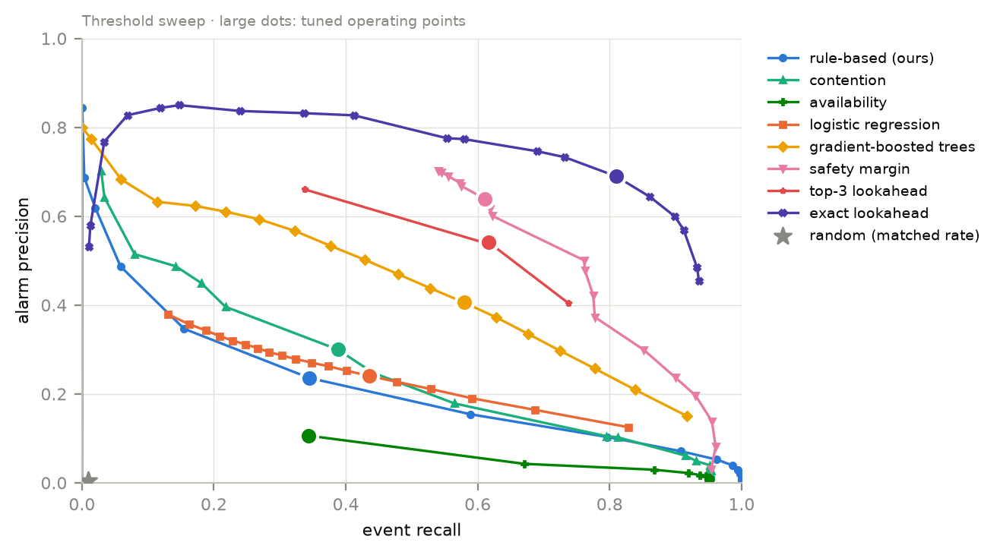
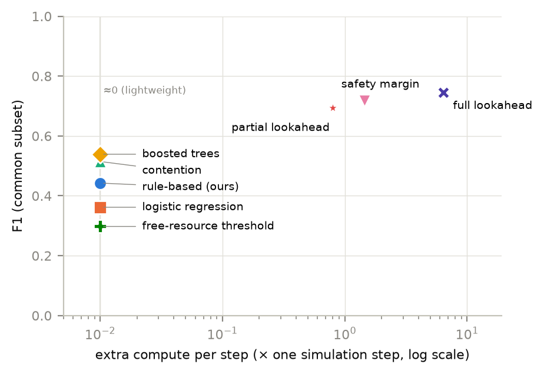
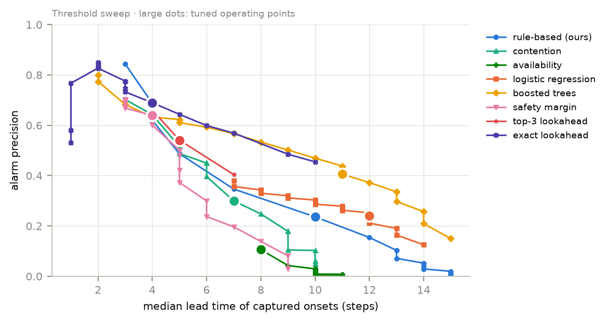
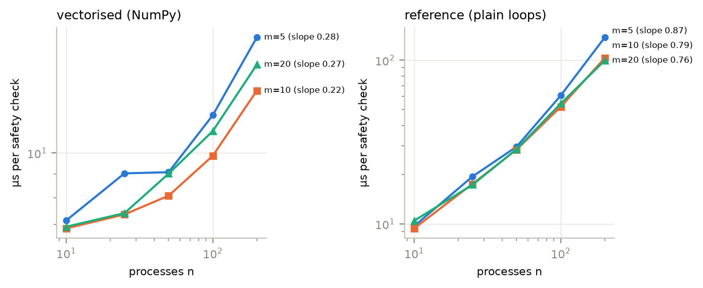

# 1. The paper in one minute

Operating systems hand out resources (memory blocks, printers, GPUs, locks) to processes. If they hand them out carelessly, processes can end up stuck forever, each holding something another one needs. That is a **deadlock**.

The classic textbook defence is **Banker's algorithm**. Before granting a request it asks: *"If I grant this, can everyone still finish in some order?"* If yes, the state is **safe**. If no, it is **unsafe**. But Banker's algorithm only answers **"are we safe right now?"** It never says **"we are heading towards danger."**

Our paper asks a new question: **can we warn *before* the system becomes unsafe — how early, how accurately, and at what cost?** Think of it as a smoke detector that beeps before the fire alarm.

What we found, in plain words:

- A **cheap rule-based score** (our method) warns about **10 steps early**. It catches about a third of the dangerous moments, and about 1 in 4 of its alarms is correct. That is far better than guessing (random alarms) and better than simply watching free resources. It is **not** the most accurate method.
- A **machine-learning model** fed the same cheap signals does clearly better (F1 0.48 vs 0.28).
- Methods that **run Banker's algorithm a few extra times** are the most accurate (F1 0.62–0.75), but they **warn later** (about 4 steps ahead) and **cost more compute**.
- A **safety margin** (7 Banker checks per step) comes within **0.03** of the most accurate method (exact lookahead), which for 200 processes costs about **43 times** a normal step.
- **Best practical design:** run the cheap score all the time, and run the costlier safety check only when the cheap score raises an alarm.

Everything was tested in a **simulator**, not on a real operating system. That is the main limitation.

# 2. Background you need

## 2.1 Resources, claims and needs

Imagine a bank with a fixed amount of cash (the **resources**). Each customer (a **process**) declares up front the **maximum loan** they might ever need (the **maximum claim**). At any moment:

- **Allocation**: what each customer already has.
- **Need**: maximum claim minus allocation, i.e. how much more they might still ask for.
- **Available**: the cash still in the bank.

A system has *n* processes and *m* resource types (for example 200 processes and 20 resource types).

## 2.2 Safe, unsafe and deadlocked

- **Safe**: there is *some* order in which every customer can get their full need, finish, and return everything. Nobody can get stuck.
- **Unsafe**: no such order is guaranteed. Getting stuck is *possible*, but not certain, because some customers may never ask for their full maximum.
- **Deadlocked**: some processes are actually stuck right now, each waiting for something another holds.

Key fact: **a deadlocked state is always unsafe, but an unsafe state is not always deadlocked.** Unsafe is the "danger zone"; deadlock is the "crash". Our paper's main target is predicting entry into the danger zone (**unsafe onset**), and its second target is predicting the crash (**deadlock onset**).

## 2.3 Why "observer mode"?

If we let Banker's algorithm refuse dangerous requests, the system would never become unsafe and there would be nothing to predict. So our simulator **grants every valid request** and runs Banker's algorithm only to **watch** and record when the state becomes unsafe. This is called **observer mode**.

# 3. What we built

## 3.1 The simulator

At every **step**:

1. Waiting processes are retried (first come, first served).
2. One process makes a new request. It is granted if enough is free; otherwise the process waits.
3. Finished processes give everything back.
4. (Normal workload only) a process may return part of its resources early.
5. We record: is the state unsafe? Is it deadlocked? What are the warning signals?

A run of the simulator is called a **sequence**. It ends at the first deadlock, when all processes finish, or at a step limit.

We checked the simulator with **134 automated tests**. For example, our fast Banker's check gives the same answer as the textbook version on 2,000 random states.

## 3.2 Three workloads (kinds of behaviour)

| Workload | What happens | Real-life analogy |
|---|---|---|
| **Normal** | Small requests, sometimes early releases. Danger builds slowly. | A steady office server |
| **Spike** | Normal at first, then suddenly 80% of processes grab big chunks. | Many jobs starting at once on a cluster |
| **Deadlock-prone** | Process *i* prefers resource *i+1*, which creates circular waiting. | The classic "dining philosophers" pattern |

Each workload was run at **5 sizes**: 10, 25, 50, 100 and 200 processes.

## 3.3 The five warning signals (indicators)

Each is a number between 0 and 1, computed every step at almost no cost:

| Indicator | Meaning in simple words |
|---|---|
| **Scarcity** | How much of the total resources is already handed out. |
| **Need pressure** | How large the outstanding needs are compared with what is free. |
| **Contention** | For how many resource types at least two processes need more than is free (they will fight). |
| **Waiting ratio** | What fraction of processes are blocked, waiting. |
| **Request rate** | Whether requests are suddenly speeding up. |

## 3.4 Our method: the rule-based score

We combine the five indicators into one **risk score from 0 to 100** (a weighted average). An **alarm** goes off when the score stays above a **threshold** for *k* steps in a row. After an alarm there is a short quiet period (*R* steps) so it does not beep continuously. There is no machine learning, so every alarm can be explained ("contention was high").

## 3.5 The twelve methods we compared

| Method | Idea | Cost |
|---|---|---|
| Random | Alarms at random, at the same rate as ours (the "guessing" baseline). | free |
| Availability | Alarm when free resources run low (the obvious simple rule). | free |
| 4 single indicators | Use just one indicator alone. | free |
| **Rule-based (ours)** | Weighted average of all five indicators. | free |
| Rule-based, max | Use the most alarming indicator instead of the average. | free |
| Logistic regression | Simple ML model on the same signals. | free |
| Boosted trees | Stronger ML model (gradient-boosted decision trees) on the same signals. | free |
| Safety margin | "How much free resource could disappear before we become unsafe?" Needs 7 Banker checks. | moderate |
| Top-3 lookahead | "If the 3 biggest requests were granted, would we become unsafe?" Up to 3 Banker checks. | moderate |
| Exact lookahead | Same question for **every** running process. One Banker check per process. | high (grows with *n*) |

"Free" means almost no extra compute. The last three are **state-based checks**: they run Banker's algorithm on hypothetical futures.

## 3.6 How we judged a warning

We borrowed this from hospital early-warning systems (which predict patient deterioration) and earthquake early warning.

- An alarm is **correct (true)** if the system becomes unsafe within the next **20 steps** (the **horizon**). Otherwise it is a **false alarm**.
- An unsafe onset is **caught** if a correct alarm came before it. An alarm *at* the onset step does not count; that is detection, not prediction.
- **Precision** = correct alarms ÷ all alarms. *"When it beeps, how often is it right?"*
- **Recall** = caught onsets ÷ all onsets. *"Of all dangers, how many did it warn about?"*
- **F1** = one number that balances precision and recall (0 = useless, 1 = perfect). It is the **main score** in the paper.
- **Lead time** = how many steps before the onset the alarm came. *"How much warning did we get?"*
- **False alarms per 1,000 steps** = how annoying the method is.
- **NAB score** = a score from 0 (silent) to 100 (perfect, earliest possible warning) that rewards early warnings.

## 3.7 Fair testing

- **Tuning vs test.** Each method's settings (threshold, *k*, *R*, weights) were chosen on **tuning sequences** (45,000), and all reported numbers come from **separate test sequences** (150,000). This is like practising on one exam paper and being graded on a different one.
- **Tuning rule**: maximise F1, with at most 5 false alarms per 1,000 steps and at least 3 steps of median warning.
- **Scale**: 195,000 sequences and 440 million simulation steps on one AWS EC2 machine with 32 CPU cores, taking 5 h 40 min and about $8.39.

## 3.8 Two pieces of statistics, explained

**Confidence interval (CI).** "F1 0.280 [0.277, 0.283]" means we are 95% confident the true value lies between 0.277 and 0.283. It is narrow because we have so much data.

**Independent batches.** A reviewer could say: "your intervals are narrow only because all runs come from the same generator." So we split the 150,000 test sequences into **20 independent batches** and checked every comparison **inside each batch**. If method A beats B in **20 out of 20** batches, the result is very solid.

**Equivalence test (TOST).** To claim two methods are "about equally good" you cannot just say "the numbers look close". You must pick a tolerance in advance (we used ±0.05 F1) and show statistically that the difference lies inside it. That is what TOST (two one-sided tests) does.

# 4. The three hypotheses and their verdicts

| | Hypothesis | Verdict |
|---|---|---|
| **H1** | The rule-based score warns better than random alarms and the free-resource rule. | **Supported**: better in 20/20 batches. |
| **H2** | The cheap safety margin is equivalent to the expensive exact lookahead (within ±0.05 F1). | **Supported, but exploratory**: they differ by 0.027 and are equivalent within ±0.05. The ±0.05 was chosen after seeing the data. |
| **H3** | Claim-based indicators do not break when declared maximum claims are slightly wrong. | **Supported for random errors** (change ≤ 0.004). Systematic under-claiming was **not tested**. |

Honesty note: these hypotheses were written **after** our earlier exploratory runs, not before. The paper says so openly. That is why every result is called "exploratory".

# 5. Every table explained (with the full tables)

Each table below is copied from the paper with the same numbers, followed by what each column means, how the key numbers were produced, and what to conclude.

## Table I — Scope of related work

| Study | Type | Setting | Banker safety | Forecast of transition | Lead time | Event-based evaluation | Cost per method |
|---|---|---|---|---|---|---|---|
| Dijkstra; Habermann | P | Avoidance by safety test | Yes | – | – | – | – |
| Gold; Minoura; Kameda | P | Complexity of deciding avoidability | Yes | – | – | – | complexity |
| Belik; Finkel; Zohora | P | Faster or dynamic safety tests | Yes | – | – | – | Yes |
| Andrews & Levin | P | Safety of prospective requests | Yes | – | – | – | – |
| Agrawal; Chandy | P | Deadlock detection (databases, distributed) | – | – | – | – | Yes |
| Kalhauge; Tunç | P | Lock-order deadlocks in program traces | – | – | – | – | Yes |
| Le Ngoc | P | ML load balancing in CloudSim | – | Yes | – | – | – |
| Oluwaseyi | A | AI thread-deadlock prediction (proposal) | – | Yes | – | – | – |
| Ezpeleta; Li | P | Petri-net deadlock control (manufacturing) | – | – | – | – | – |
| Hyland; Münchmeyer | P | Clinical / seismic early warning | – | Yes | Yes | Yes | – |
| **This work** | | Early warning of Banker-unsafe states | **Yes** | **Yes** | **Yes** | **Yes** | **Yes** |

**Columns.**

- **Type**: P = peer-reviewed paper; A = preprint, not yet peer-reviewed.
- **Banker safety**: does the work use the safe/unsafe idea?
- **Forecast of transition**: does it predict a change *before* it happens?
- **Lead time**: does it measure *how early* the warning comes?
- **Event-based evaluation**: does it score whole events (as hospitals do) rather than single time steps?
- **Cost per method**: does it measure compute cost?

**Reading the rows.**

- The first four rows are the Banker's-algorithm family. They all say "Yes" to Banker safety but "–" to forecasting and lead time: they only answer "safe *now*?".
- Detection papers (Agrawal, Chandy) find a deadlock *after* it forms.
- Lock-order papers (Kalhauge, Tunç) predict a different kind of deadlock: bugs in program code, not resource allocation.
- Le Ngoc and Oluwaseyi do forecast, but not Banker's unsafe state, and do not measure lead time.
- Hospital and earthquake early warning (Hyland, Münchmeyer) have the right *evaluation method* but nothing to do with Banker's algorithm.
- **Only our row has "Yes" in all five columns.**

**Conclude.** This table is the answer to "how is your work different from existing work?" Each existing line of work covers part of the problem; none forecasts Banker's unsafe state with measured lead time and cost.

## Table II — Methods compared

| Method | Signal | Trained | Cost |
|---|---|---|---|
| Random | Bernoulli, matched rate | no | ≈0 |
| Availability | free fraction of units | no | ≈0 |
| Single indicators (4) | need pressure, contention, waiting ratio or request rate | no | ≈0 |
| Rule-based (ours) | weighted mean of 5 indicators | no | ≈0 |
| Rule-based, max | weighted maximum | no | ≈0 |
| Logistic regression | 5 indicators + 10-step changes | yes | ≈0 |
| Boosted trees | same features | yes | ≈0 |
| Safety margin | binary search over free units (7 checks) | no | 1.66 |
| Top-3 lookahead | ≤3 prospective-grant checks | no | 0.91 |
| Exact lookahead | 1 check per running process | no | 43.45 |

**Columns.**

- **Signal**: what the method looks at.
- **Trained**: "yes" means it is a machine-learning model that learned from data.
- **Cost**: extra compute per step *at 200 processes*, as a multiple of one normal simulation step. 1.66 means the method costs 1.66 extra simulation steps of work every step; ≈0 means negligible.

**Notes on specific rows.**

- **Random, Bernoulli, matched rate**: a coin flip at every step, with the coin weighted so it raises about as many alarms as our method. If a method cannot beat this, it is useless.
- **Logistic regression, "5 indicators + 10-step changes"**: the five indicators plus how much each changed over the last 10 steps (so the model can see trends).
- **Safety margin, "7 checks"**: a binary search, like guessing a number by halving, needs about 7 Banker checks to find how much free resource could disappear before the state turns unsafe.
- **Exact lookahead, 43.45**: one Banker check for each running process. With 200 processes that is up to 200 checks, so it costs about 43 normal steps.

**Conclude.** Nine methods are essentially free; three use Banker's algorithm and cost real compute, one of them a lot.

## Table III — Claim taxonomy

| Class | Claimed | Not claimed |
|---|---|---|
| Correctness | Simulator invariants; fast Banker check = textbook check on 2,000 random states; deadlocked implies unsafe (134 tests) | A formal proof of the simulator |
| Warning accuracy | Precision, recall, F1 and lead time in these workloads and sizes | Accuracy on real systems or other workload families |
| Replication | Rankings hold in 20 of 20 seed batches | Stability under re-tuning or a different generator |
| Equivalence | Safety margin within ±0.05 F1 of exact lookahead (tolerance chosen after the fact) | Equivalence at tighter tolerances; "no difference" |
| Cost | Per-step compute of our NumPy implementation | Cost of other implementations or incremental tests |
| Deadlock outcome | Fraction of unsafe episodes ending in deadlock in this simulator | That unsafe states usually deadlock in real systems |
| Robustness | Insensitivity to unbiased ±20% per-entry claim error | Robustness to biased misdeclaration |

**Reading it.** The middle column is what our evidence supports; the right column is what someone might *wrongly* read into our results.

- **Correctness, 2,000 random states**: our fast Banker check gave the same answer as the textbook version on 2,000 random states.
- **Deadlocked implies unsafe**: every deadlocked state we generated was also unsafe, as the theory says.
- **134 tests**: automated checks that run every time the code changes.
- **Replication, 20 of 20**: see Table VII.
- **Equivalence, ±0.05**: see Table VII and Figure 2.

**Conclude.** This is the "honesty table". If anyone asks "so this works on real systems?", the answer is in the right column: not claimed.

## Table IV — Experimental runs

| Run | Machine | Sequences | Steps | Purpose |
|---|---|---|---|---|
| 1. Pilot | laptop | 48,000 | 55.7 M | pipeline check; not reported |
| 2. Exploratory | AWS EC2, 32 vCPUs | 300,000 | 676.2 M | fewer methods; not reported |
| 3. Main | AWS EC2, 32 vCPUs | 195,000 | 439.6 M | all 12 methods; all results |

**Columns.**

- **Sequences**: number of separate simulations.
- **Steps**: total simulator ticks (M = million).
- **vCPUs**: virtual CPU cores on the cloud machine.

**The numbers.**

- **Run 1** was on our laptop, to make sure the whole pipeline (simulate, tune, evaluate, make figures) works end to end.
- **Run 2** was bigger (676 million steps) but had fewer methods: no ML models, safety margin or top-3 lookahead.
- **Run 3** (195,000 sequences = 45,000 tuning + 150,000 test, 439.6 million steps) took 5 h 40 min and cost about $8.39 on AWS.

**Conclude.** Only Run 3 is reported, and the runs are never mixed. Runs 1 and 2 shaped our hypotheses, which is why the paper calls its results exploratory.

## Table V — Test set per workload and size

| Workload | n | m | Sequences | Steps | Unsafe onsets | % sequences with an onset | % ending in deadlock | Claim tightness |
|---|---|---|---|---|---|---|---|---|
| Normal | 10 | 5 | 10,000 | 1,071,547 | 2,754 | 26.9 | 25.4 | 1.43 |
| Normal | 25 | 8 | 10,000 | 4,494,155 | 1,674 | 15.7 | 14.3 | 1.43 |
| Normal | 50 | 10 | 10,000 | 11,527,074 | 1,270 | 11.3 | 10.1 | 1.43 |
| Normal | 100 | 20 | 10,000 | 39,280,274 | 8,469 | 65.8 | 62.7 | 1.43 |
| Normal | 200 | 20 | 10,000 | 82,123,372 | 7,358 | 56.2 | 53.6 | 1.43 |
| Spike | 10 | 5 | 10,000 | 707,662 | 7,066 | 70.7 | 70.7 | 1.58 |
| Spike | 25 | 8 | 10,000 | 2,939,715 | 5,954 | 59.5 | 59.5 | 1.58 |
| Spike | 50 | 10 | 10,000 | 7,434,425 | 5,317 | 53.2 | 53.2 | 1.58 |
| Spike | 100 | 20 | 10,000 | 27,023,589 | 6,185 | 61.9 | 61.9 | 1.58 |
| Spike | 200 | 20 | 10,000 | 56,973,051 | 5,346 | 53.5 | 53.5 | 1.58 |
| Deadlock-prone | 10 | 5 | 10,000 | 1,020,230 | 4,073 | 40.7 | 40.7 | 1.48 |
| Deadlock-prone | 25 | 8 | 10,000 | 4,036,769 | 4,047 | 40.5 | 40.5 | 1.48 |
| Deadlock-prone | 50 | 10 | 10,000 | 9,877,410 | 4,513 | 45.1 | 45.1 | 1.48 |
| Deadlock-prone | 100 | 20 | 10,000 | 29,793,804 | 9,316 | 93.2 | 93.2 | 1.48 |
| Deadlock-prone | 200 | 20 | 10,000 | 59,959,348 | 9,270 | 92.7 | 92.7 | 1.48 |

**Columns.**

- **n**: number of processes. **m**: number of resource types.
- **Sequences**: 10,000 per row, giving 15 rows × 10,000 = 150,000 test sequences.
- **Steps**: total simulator ticks in that row; all rows add up to 338,262,425.
- **Unsafe onsets**: how many times the system entered an unsafe state. These are the "dangers" a method must warn about; 82,612 in total.
- **% sequences with an onset**: what fraction of the 10,000 runs had at least one danger. The rest stayed safe the whole time, which tests whether a method stays quiet when nothing is wrong.
- **% ending in deadlock**: what fraction of runs ended in an actual deadlock.
- **Claim tightness**: total declared maximum claims ÷ total resources. 1.43 means processes together *could* ask for 43% more than exists, which makes danger possible but not certain.

**Reading specific numbers.**

- **Normal, n=10: 26.9% have an onset, 25.4% deadlock.** The 1.5-point gap means a few normal sequences became unsafe but recovered. Normal is the only workload where processes release resources early.
- **Spike and deadlock-prone: the two % columns are identical.** In those workloads, once a sequence became unsafe it always went on to deadlock (also see Table XIII).
- **Steps grow with n** (707,662 for spike n=10 vs 56,973,051 for n=200), because bigger systems have more requests before finishing.
- **Deadlock-prone, n=100 and 200: 93% have an onset.** Circular-wait preferences almost always lead to danger in large systems.

**Conclude.** The test set is large and balanced: every workload has both dangerous and quiet runs, so a method cannot score well by always alarming or never alarming.

## Table VI — Main results (the most important table)

All 150,000 test sequences, 82,612 unsafe onsets, 20-step horizon.

| Method | Precision | Recall | F1 [95% CI] | False alarms | Median lead | NAB score |
|---|---|---|---|---|---|---|
| Rule-based (ours) | 0.236 | 0.344 | 0.280 [0.277, 0.283] | 0.333 | 10 | 22.1 |
| Contention | 0.300 | 0.388 | 0.338 [0.336, 0.341] | 0.221 | 7 | 27.2 |
| Rule-based, max | 0.300 | 0.388 | 0.338 [0.336, 0.341] | 0.221 | 7 | 27.2 |
| Need pressure | 0.314 | 0.136 | 0.190 [0.187, 0.193] | 0.072 | 7 | 9.5 |
| Waiting ratio | 0.242 | 0.259 | 0.250 [0.248, 0.252] | 0.307 | 13 | 16.6 |
| Request rate | 0.161 | 0.116 | 0.135 [0.133, 0.137] | 0.148 | 9 | 6.6 |
| Availability | 0.106 | 0.344 | 0.162 [0.160, 0.164] | 0.708 | 8 | 13.0 |
| Logistic regression | 0.240 | 0.435 | 0.310 [0.307, 0.312] | 0.480 | 12 | 28.3 |
| Boosted trees | 0.406 | 0.579 | 0.477 [0.475, 0.480] | 0.292 | 11 | 45.0 |
| Safety margin | 0.639 | 0.611 | 0.625 [0.622, 0.627] | 0.084 | 4 | 43.8 |
| Top-3 lookahead | 0.541 | 0.617 | 0.576 [0.574, 0.579] | 0.128 | 5 | 45.6 |
| Random (matched rate) | 0.005 | 0.009 | 0.006 [0.006, 0.006] | 0.438 | 11 | – |

**How each number of our method (first row) was calculated.**

- **Precision 0.236.** Our method raised **147,529 alarms**, of which **34,836** were followed by an unsafe onset within 20 steps: 34,836 ÷ 147,529 = 0.236. About **1 in 4 alarms is right**.
- **Recall 0.344.** Of the **82,612 onsets**, **28,439** had a correct alarm before them: 28,439 ÷ 82,612 = 0.344. We warned about **about 1 in 3 dangers**. (34,836 correct alarms but only 28,439 onsets caught, because sometimes two alarms came before the same onset.)
- **F1 0.280** = 2 × 0.236 × 0.344 ÷ (0.236 + 0.344). It is the balance of the two; F1 is high only if *both* are high.
- **[0.277, 0.283]** is the 95% confidence interval. It is narrow because there is so much data.
- **False alarms 0.333 per 1,000 steps.** 112,693 wrong alarms over 338 million steps is one wrong alarm every ~3,000 steps.
- **Median lead 10**: half of the caught dangers were warned about 10 or more steps in advance.
- **NAB score 22.1** on a 0–100 scale, where 0 = never warns and 100 = perfect earliest warning. It rewards earlier warnings and penalises misses and false alarms.

**Comparing rows.**

- **Random: precision 0.005, F1 0.006.** Guessing at the same alarm rate as ours is right 0.5% of the time. Our 0.236 is about **47× better than guessing**.
- **Availability (just "free resources are low"): F1 0.162**, with the most false alarms (0.708 per 1,000 steps). The obvious rule is noisy. We beat it by 0.118.
- **Contention: F1 0.338, better than ours.** One signal alone beats our average of five (see Table IX for why). It warns a bit later (7 vs 10 steps).
- **Rule-based, max: identical to contention.** Our tuned weights count contention double, so the maximum always comes from contention. That is a design effect, not a mistake.
- **Need pressure: precision 0.314 but recall only 0.136.** It is cautious: when it fires it is often right, but it misses most dangers.
- **Waiting ratio: longest lead (13 steps)**, but lower precision.
- **Boosted trees: F1 0.477, best of the cheap methods.** The same cheap signals, combined by ML, are almost twice as good as our weighted average.
- **Safety margin: F1 0.625, precision 0.639, only 0.084 false alarms**, the most precise and least noisy, but a median lead of only **4 steps**.
- **Top-3 lookahead: F1 0.576, lead 5.**
- **Exact lookahead is missing here**: it was computed only on a subset, so it appears in Table VIII.

**Conclude.** Our cheap score works (far above random and availability) and gives the longest useful warning among the good methods. The Banker-based checks are more accurate but warn later and cost more. ML on the same signals is a clear improvement path.

## Table VII — Paired differences across 20 independent batches

Difference = first method's F1 minus second method's F1, computed separately in each of 20 batches of 7,500 sequences.

| Comparison | Set | F1 difference [95% CI] | Wins |
|---|---|---|---|
| Rule-based vs random | all | +0.274 [0.270, 0.278] | 20/20 |
| Rule-based vs availability | all | +0.118 [0.115, 0.121] | 20/20 |
| Rule-based vs contention | all | −0.058 [−0.062, −0.055] | 0/20 |
| Rule-based vs logistic regression | all | −0.030 [−0.033, −0.027] | 0/20 |
| Rule-based vs boosted trees | all | −0.197 [−0.201, −0.193] | 0/20 |
| Rule-based vs safety margin | all | −0.344 [−0.348, −0.341] | 0/20 |
| Safety margin vs exact lookahead | subset | −0.027 [−0.031, −0.023] | 0/20 |
| Top-3 vs exact lookahead | subset | −0.052 [−0.055, −0.049] | 0/20 |
| Boosted trees vs exact lookahead | subset | −0.206 [−0.212, −0.200] | 0/20 |
| Rule-based vs exact lookahead | subset | −0.302 [−0.311, −0.294] | 0/20 |

**Why this table exists.** Table VI gives one number per method. A reviewer can ask: "if you ran it again on different data, would the ranking hold?" So we cut the test sequences into **20 separate batches** (each with an equal share of every workload and size) and compared the methods inside each batch. Each batch is like a separate repeat of the experiment.

**Columns.**

- **Set**: "all" = the full 150,000 sequences; "subset" = the 61,350 sequences where exact lookahead was computed (Table VIII).
- **F1 difference**: the average over 20 batches of (first − second). Positive means the first method is better.
- **95% CI**: the range in which the true difference lies. If it does not include 0, the difference is real.
- **Wins**: in how many of the 20 batches the first method was ahead.

**Reading the rows.**

- **+0.274 vs random, 20/20** and **+0.118 vs availability, 20/20**: our method wins every single time. This confirms **hypothesis H1**.
- **−0.058 vs contention, 0/20**: contention beats us in every batch, so this is a real effect, not luck.
- **−0.030 vs logistic regression** and **−0.197 vs boosted trees, 0/20**: the ML models are reliably better.
- **Safety margin vs exact lookahead: −0.027 [−0.031, −0.023], 0/20.** The margin is slightly worse every time, but only by about 0.03 F1. Because the whole interval lies inside ±0.05, the two count as **equivalent within ±0.05** (that is the TOST test; the 90% interval used for it is [−0.030, −0.024]). **Hypothesis H2.**
- **Top-3 vs exact lookahead: −0.052.** Just outside ±0.05, so top-3 is *not* equivalent to exact lookahead.
- **None of the intervals contains zero**, so every ranking in the paper is reliable.
- We also tried 10 and 50 batches: same results.

**Conclude.** All the rankings are solid. Our method reliably beats the baselines and reliably loses to the ML and Banker-based methods. The cheap safety margin is reliably within 0.03 of the expensive exact lookahead.

## Table VIII — All methods on the common subset

61,350 sequences (all with n ≤ 25, plus 200 per cell for n = 50 and 100, and 50 per cell for n = 200), 26,382 onsets.

| Method | F1 [95% CI] | False alarms | Median lead |
|---|---|---|---|
| Exact lookahead | 0.745 [0.741, 0.749] | 0.624 | 4 |
| Safety margin | 0.718 [0.714, 0.722] | 0.543 | 4 |
| Top-3 lookahead | 0.693 [0.689, 0.698] | 0.683 | 5 |
| Boosted trees | 0.539 [0.535, 0.543] | 2.394 | 10 |
| Contention | 0.515 [0.510, 0.520] | 1.039 | 6 |
| Rule-based (ours) | 0.443 [0.437, 0.448] | 0.481 | 5 |
| Logistic regression | 0.362 [0.359, 0.365] | 5.442 | 12 |
| Request rate | 0.333 [0.327, 0.338] | 0.516 | 8 |
| Availability | 0.298 [0.292, 0.303] | 0.351 | 4 |
| Need pressure | 0.182 [0.176, 0.187] | 0.084 | 4 |
| Waiting ratio | 0.141 [0.136, 0.146] | 0.320 | 4 |
| Random | 0.014 [0.013, 0.014] | 0.422 | 9 |

**Why a subset?** Exact lookahead does one Banker check per process every step, which is too slow to run on all 150,000 sequences. We ran it on all small systems and a sample of large ones. To compare it **fairly**, every other method is also scored on exactly these 61,350 sequences, like grading all students on the same exam paper.

**Reading the numbers.**

- **Exact lookahead 0.745 > safety margin 0.718 > top-3 0.693.** The three Banker-based methods are the top three, all warning 4–5 steps ahead.
- **The gap between margin and exact lookahead is 0.027**: the same as in Table VII.
- **Our method scores 0.443 here vs 0.280 on the full set.** Not because it changed, but because this subset is mostly small systems, which are easier (anomaly A4).
- **Logistic regression: 5.442 false alarms per 1,000 steps**, much worse than on the full set (0.480). Its settings, tuned on all sizes, do not suit small systems (anomaly A6).
- **Waiting ratio drops to 0.141** (0.250 on the full set): it works better in big systems.

**Conclude.** On equal ground the Banker-based checks are clearly the most accurate, and the cheap safety margin is nearly as good as the expensive exact lookahead.

## Table IX — Ablation (removing one signal at a time)

All versions use equal weights and are re-tuned. False alarms per 1,000 steps.

| Indicators used | Precision | Recall | F1 | False alarms |
|---|---|---|---|---|
| All five | 0.17 | 0.40 | 0.24 | 0.59 |
| Without scarcity | 0.19 | 0.39 | 0.26 | 0.47 |
| Without need pressure | 0.17 | 0.45 | 0.25 | 0.64 |
| Without contention | 0.14 | 0.36 | 0.20 | 0.65 |
| Without waiting ratio | 0.23 | 0.31 | 0.27 | 0.30 |
| Without request rate | 0.15 | 0.39 | 0.22 | 0.54 |

**What "ablation" means.** Take something apart one piece at a time to see how much each piece matters, like removing one ingredient from a recipe.

**Reading the numbers.** Compare each row's F1 with the first row (0.24):

- **Without contention: 0.20 (down 0.04).** Removing it hurts most, so contention is the **most important signal**.
- **Without request rate: 0.22 (down 0.02).** It also helps.
- **Without scarcity: 0.26 (up 0.02)**, **without need pressure: 0.25 (up 0.01)** and **without waiting ratio: 0.27 (up 0.03).** Removing these *improves* the average. In a simple average they add noise that drowns out contention.
- **Without waiting ratio**, false alarms also halve (0.59 → 0.30).

Note that 0.24 here is the *equal-weight* version. The paper's final rule-based score (0.280 in Table VI) uses tuned weights in which contention counts double.

**Conclude.** A plain average of all signals is not the best combination. That is why contention alone beats our score in Table VI, and why ML models, which learn how to combine signals, do better.

## Table X — F1 per workload

20-step horizon.

| Method | Normal | Spike | Deadlock-prone |
|---|---|---|---|
| Rule-based (ours) | 0.22 | 0.42 | 0.23 |
| Rule-based, max | 0.21 | 0.49 | 0.22 |
| Need pressure | 0.06 | 0.34 | 0.01 |
| Contention | 0.21 | 0.49 | 0.22 |
| Waiting ratio | 0.29 | 0.03 | 0.31 |
| Request rate | 0.00 | 0.23 | 0.00 |
| Availability | 0.10 | 0.34 | 0.05 |
| Logistic regression | 0.22 | 0.44 | 0.23 |
| Boosted trees | 0.36 | 0.58 | 0.43 |
| Safety margin | 0.55 | 0.78 | 0.54 |
| Top-3 lookahead | 0.45 | 0.80 | 0.44 |
| Exact lookahead (subset only) | 0.66 | 0.83 | 0.69 |
| Random | 0.00 | 0.01 | 0.01 |

**Reading the numbers.** Read across a row to see how one method behaves in different situations.

- **Ours: 0.42 on spike but 0.22–0.23 on the others.** Sudden bursts are easy to notice; slow build-ups are hard. In spike runs, danger came a median **26 steps** after the burst started, giving signals time to react.
- **Spike is the easiest column for almost every method.**
- **Safety margin: 0.55 / 0.78 / 0.54.** It stays good even when danger builds slowly; the cheap methods do not.
- **Waiting ratio: 0.29 / 0.03 / 0.31.** Good normally, useless on spike. During a spike, processes grab what is free, so their requests are granted and few are waiting (anomaly A1).
- **Request rate: 0.00 / 0.23 / 0.00.** It only measures speed-ups in requests, so it only detects bursts. Makes sense.
- **Need pressure: 0.01 on deadlock-prone.** Almost useless there.
- **Boosted trees: 0.36 / 0.58 / 0.43**, the best cheap method in every workload.

**Conclude.** How good a warning method is depends on *how* danger builds up. Cheap signals are fine for sudden bursts; for slow, gradual danger, Banker-based checks are much better.

## Table XI — Compute cost

µs = microseconds (millionths of a second); × step = multiple of one simulation step.

| Computation | Average µs | Average × step | n = 200 µs | n = 200 × step |
|---|---|---|---|---|
| Simulation step | 289 | 1.00 | – | – |
| One safety check | 60 | 0.21 | – | – |
| Safety margin | 417 | 1.44 | 479 | 1.66 |
| Top-3 lookahead | 231 | 0.80 | 264 | 0.91 |
| Exact lookahead | 1,850 | 6.40 | 12,566 | 43.45 |

**Columns.** "Average" is over all system sizes; "n = 200" is for the largest systems (200 processes).

**Reading the numbers.**

- **One simulation step = 289 µs.** That is everything the simulator does in one tick, including one Banker check and computing the five indicators. This is our unit of cost.
- **One safety check = 60 µs = 0.21 steps.**
- **Safety margin = 417 µs on average (1.44×), 479 µs at n = 200 (1.66×).** It barely grows with size, because it always does about 7 checks.
- **Top-3 lookahead: 0.80× → 0.91×.** At most 3 checks, so it also barely grows.
- **Exact lookahead: 6.40× on average, but 43.45× at n = 200 (12.6 milliseconds per step).** It does one check per process, so the bigger the system, the more it costs.
- The cheap methods are not listed because their extra cost is negligible.

**Important caveat.** These are timings of *our* Python/NumPy code on one machine. Faster code would change the microseconds, so the **ratios** (fixed 7 checks vs one check per process) are the lasting lesson.

**Conclude.** Safety margin costs about the same as one extra simulation step no matter the size. Exact lookahead becomes very expensive in big systems: about 26× costlier than the safety margin at n = 200 (43.45 ÷ 1.66).

## Table XII — Predicting deadlock (instead of unsafe)

Predicting deadlock onsets up to 20 steps ahead. The first three numbers are on the common subset (25,862 deadlock onsets, all methods on the same sequences); the last column is on the full population (77,700 onsets).

| Method | Precision | Recall | F1 (subset) | F1 (full) |
|---|---|---|---|---|
| Rule-based (ours) | 0.582 | 0.759 | 0.659 | 0.326 |
| Availability | 0.523 | 0.585 | 0.552 | 0.161 |
| Boosted trees | 0.374 | 0.969 | 0.540 | 0.476 |
| Contention | 0.390 | 0.772 | 0.518 | 0.262 |
| Need pressure | 0.621 | 0.426 | 0.505 | 0.235 |
| Waiting ratio | 0.413 | 0.499 | 0.452 | 0.476 |
| Logistic regression | 0.242 | 0.920 | 0.384 | 0.286 |
| Exact lookahead | 0.320 | 0.434 | 0.369 | – |
| Safety margin | 0.317 | 0.370 | 0.342 | 0.155 |
| Top-3 lookahead | 0.269 | 0.343 | 0.301 | 0.128 |
| Request rate | 0.242 | 0.174 | 0.202 | 0.064 |
| Random | 0.030 | 0.009 | 0.014 | 0.006 |

**What changes from Table VI.** The target is now the **actual deadlock** (the crash), not the unsafe state (the danger zone). Same alarms, same settings, different question: "did a deadlock follow within 20 steps?"

**Reading the numbers.**

- **Ours: F1 0.659, the best of all.** On the subset it catches 75.9% of deadlocks (recall 0.759), and 58.2% of its alarms are right.
- **Boosted trees: recall 0.969**: it catches almost every deadlock, but with lower precision (0.374): it alarms a lot (anomaly A2).
- **Exact lookahead 0.369, safety margin 0.342, top-3 0.301.** The best unsafe-state predictors are among the *worst* deadlock predictors. They are only computed while the system is still safe, so they go silent during the unsafe stretch just before the deadlock (anomaly A3).
- **The F1 (full) column** is the same method on all sequences, minus exact lookahead, which wasn't run on all of them. The numbers differ (for example ours 0.326) because the full set has many more large systems, which behave differently. **Never compare numbers from different populations**; that was the mistake in our earlier version of this table.

**Conclude.** When predicting actual deadlocks on equal ground, our cheap rule-based score is the best method. Which method is "best" depends on whether you want to predict the danger zone or the crash.

## Table XIII — How unsafe episodes ended

| Workload | Recovered | Deadlocked | % deadlocked |
|---|---|---|---|
| Normal | 4,912 | 16,613 | 77 |
| Spike | 0 | 29,868 | 100 |
| Deadlock-prone | 0 | 31,219 | 100 |

**Definitions.**

- **Episode**: one continuous stretch of being unsafe.
- **Recovered**: the system became safe again.
- **Deadlocked**: the episode ended in a deadlock.

**Reading the numbers.**

- **Normal: 4,912 recovered + 16,613 deadlocked = 21,525 episodes**, and 16,613 ÷ 21,525 = **77%** deadlocked. Recovery happens only here, because in the normal workload processes sometimes release resources early.
- **Spike: all 29,868** episodes ended in deadlock. **Deadlock-prone: all 31,219.**

**Important caveat.** This is mainly a property of **our simulator**, not of real systems. In our simulator every process eventually asks for its full maximum claim, and a run stops at the first deadlock. In real systems processes often never use their full claim, so many unsafe states never become deadlocks.

**Conclude.** In our simulator, unsafe usually means deadlock is coming (77–100%), which is why warning about unsafe states matters here. Do not quote this as a real-world rate.

## Table XIV — Robustness to wrong claims

| Method | True claims | Claims ±20% | Change |
|---|---|---|---|
| Rule-based (ours) | 0.280 | 0.280 | +0.000 |
| Rule-based, max | 0.338 | 0.337 | −0.001 |
| Need pressure | 0.190 | 0.194 | +0.004 |
| Contention | 0.338 | 0.337 | −0.001 |
| Logistic regression | 0.310 | 0.311 | +0.002 |
| Boosted trees | 0.477 | 0.476 | −0.001 |

**What we tested.** In real systems, programs may declare wrong maximum claims. So every declared claim number was randomly changed by up to ±20% (for example a true 10 could be declared as anything from 8 to 12). The methods used these *wrong* claims; the ground truth (what is really unsafe) still used the true claims.

**Columns.** F1 with the true claims, F1 with ±20% wrong claims, and the change.

**Reading the numbers.** Every change is between **−0.001 and +0.004**. Ours did not change at all (0.280 → 0.280). Only the methods that use claims are listed; the others (waiting ratio, request rate, availability) do not use claims, so they cannot be affected.

**Limitation.** Random errors cancel out: some claims go up, some go down, and our signals add many of them together. A *systematic* error (everyone under-declaring by 20%) would not cancel. We did not test that.

**Conclude.** The methods are robust to random mistakes in declared claims. Robustness to systematic mistakes is unknown.

## Table XV — Changing the warning horizon

F1 when an alarm counts as correct if an unsafe onset follows within 5, 10, 20 or 50 steps (same alarms).

| Method | 5 steps | 10 | 20 | 50 |
|---|---|---|---|---|
| Rule-based (ours) | 0.108 | 0.190 | 0.280 | 0.399 |
| Contention | 0.129 | 0.222 | 0.338 | 0.432 |
| Boosted trees | 0.178 | 0.330 | 0.477 | 0.597 |
| Safety margin | 0.374 | 0.490 | 0.625 | 0.707 |
| Top-3 lookahead | 0.295 | 0.433 | 0.576 | 0.691 |
| Exact lookahead (subset only) | 0.482 | 0.648 | 0.745 | 0.798 |
| Availability | 0.055 | 0.097 | 0.162 | 0.251 |
| Random | 0.002 | 0.003 | 0.006 | 0.015 |

**What the horizon is.** How far ahead an alarm may come and still count as correct. The paper's main choice is **20 steps** (the third column, which matches Table VI). Here we rescore the *same* alarms with stricter (5, 10) and looser (50) rules.

**Reading the numbers.**

- **Ours: 0.108 → 0.190 → 0.280 → 0.399.** With a 50-step horizon our F1 almost doubles compared with 20 steps. Many alarms we counted as "false" at 20 steps were actually followed by danger 20–50 steps later: **real but very early warnings**.
- **Every method improves** as the horizon widens, because looser rules count more alarms as correct.
- **The order of methods is the same in every column.** Exact lookahead > safety margin > top-3 > boosted trees > contention > ours > availability > random, in all four columns.

**Conclude.** Our conclusions do not depend on choosing 20 steps. And our method's early alarms are often more useful than the 20-step score suggests.

## Table XVI — Speed of the Banker's safety check

Time per check on random valid states, in µs.

| n | m | Vectorised (µs) | Textbook (µs) | Speed-up |
|---|---|---|---|---|
| 10 | 5 | 7.1 | 9.7 | 1.4 |
| 10 | 10 | 6.9 | 9.4 | 1.4 |
| 10 | 20 | 6.9 | 10.5 | 1.5 |
| 25 | 5 | 9.0 | 19.5 | 2.2 |
| 25 | 10 | 7.4 | 17.6 | 2.4 |
| 25 | 20 | 7.4 | 17.3 | 2.3 |
| 50 | 5 | 9.1 | 29.6 | 3.3 |
| 50 | 10 | 8.1 | 28.4 | 3.5 |
| 50 | 20 | 9.0 | 28.6 | 3.2 |
| 100 | 5 | 12.1 | 60.8 | 5.0 |
| 100 | 10 | 9.9 | 51.9 | 5.3 |
| 100 | 20 | 11.2 | 54.3 | 4.9 |
| 200 | 5 | 17.8 | 138.0 | 7.7 |
| 200 | 10 | 13.7 | 103.3 | 7.6 |
| 200 | 20 | 15.6 | 99.7 | 6.4 |

**Columns.**

- **n** processes and **m** resource types.
- **Vectorised**: our NumPy version, which checks many processes at once.
- **Textbook**: the loop from the Silberschatz/Tanenbaum textbooks.
- **Speed-up**: textbook ÷ vectorised.

**Reading the numbers.**

- **n = 10, m = 5: 7.1 vs 9.7 µs, 1.4× faster.** For tiny systems both are fast.
- **n = 200, m = 5: 17.8 vs 138.0 µs, 7.7× faster.** The bigger the system, the bigger our advantage.
- **Growth.** From n = 10 to n = 200 (20× more processes), our time goes from about 7 to about 16 µs (roughly 2×), while the textbook goes from about 10 to about 100 µs (roughly 10×).
- Theory says the worst case is about *m × n²*, which would be **400×** more for 20× more processes. Real states are much easier than the worst case: most processes can finish in the first few passes.
- **m (resource types) barely matters here**: rows with the same n have similar times.

These timings come from a separate test on random states, so they differ from the 60 µs average in Table XI, which was measured inside full simulations.

**Conclude.** Our vectorised Banker check is up to 7.7× faster than the textbook version and grows far more slowly than theory's worst case. That is part of why running safety checks every step is affordable in our experiments. It is average-case behaviour of one implementation, not a new theorem.

# 6. Every figure explained

## Figure 1 — Precision vs recall

**How to read it.** Each coloured line is one method, traced by moving its threshold from low to high. A **low threshold** gives many alarms: high recall but low precision (bottom right). A **high threshold** gives few alarms: high precision but low recall (top left). The **big dot** is the setting chosen during tuning. **Further up and to the right is better.** The grey star near (0, 0) is random alarms.

**What to conclude.**

- **Exact lookahead** (purple) is the highest curve: best at every trade-off point.
- **Safety margin** (pink) and **top-3 lookahead** (red) come next.
- **Boosted trees** (orange) is clearly the best of the cheap methods.
- Our **rule-based** score (blue), **contention** and **logistic regression** are close together. **Availability** (dark green) is low. **Random** is stuck at zero.
- So the ranking in Table VI is not an accident of one threshold: it holds along the whole curve.

## Figure 2 — Accuracy vs compute cost

**How to read it.** The x-axis shows extra compute per step, as a multiple of one simulation step, on a **log scale** (each grid line is 10× more). The y-axis shows F1 on the common subset. Cheap methods are drawn at the far left ("≈0"). **Top-left is ideal**: accurate and cheap.

**What to conclude.**

- Moving from the cheap methods (left) to the Banker-based checks (around 1×) gives the **big jump in accuracy** (from about 0.30–0.54 up to 0.69–0.72).
- Going further from the safety margin to exact lookahead costs **several times more** (about 6× here, averaged over sizes; 43× at 200 processes) for only **+0.027 F1**.
- **Practical message:** the safety margin is the "sweet spot" on this frontier.

## Figure 3 — Precision vs warning time

**How to read it.** The x-axis shows how early the warning comes (median lead, in steps); the y-axis shows how often an alarm is right. Each line is again a threshold sweep, and the big dots are the tuned settings. **Top-right is ideal**: early and precise.

**What to conclude.**

- There is a clear **trade-off**: earlier warnings are less precise for every method.
- The Banker-based methods' big dots sit at **4–5 steps** with precision 0.54–0.69: precise but late.
- The cheap methods' dots sit at **7–12 steps** with lower precision: early but noisier.
- **Boosted trees** (orange, 11 steps, precision 0.41) gives the best early warning among practical methods.
- This is why we suggest **combining** a cheap early score with a precise Banker-based check.

## Figure 4 — How the safety check's time grows with system size

**How to read it.** Both axes are **log scale**, so a straight line means time grows like *n* to the power "slope". The **slope** tells how fast the time grows: slope 1 means doubling *n* doubles the time, and slope 2 would mean 4× the time. Left panel: our vectorised version. Right panel: textbook loops.

**What to conclude.**

- Our vectorised version has slopes of about **0.22–0.28**: time grows very slowly with *n*.
- The textbook version has slopes of about **0.76–0.87**: close to linear.
- Both are far below the theoretical worst case (*n²*, slope 2), because typical states are easy.

# 7. Open anomalies (things we cannot fully explain yet)

Good papers admit what they do not understand. Ours lists six puzzles:

| | What we saw | Our best guess |
|---|---|---|
| **A1** | Waiting ratio works on normal and deadlock-prone (F1 0.29–0.31) but fails on spike (0.03). | In a spike, grabs are capped by free resources so they are *granted*; few processes are waiting before danger. |
| **A2** | Boosted trees catch 98.5% of deadlocks. No other method comes close. | It may simply keep alarming during the unsafe period just before a deadlock. |
| **A3** | Banker-based checks are best for unsafe states but weak for deadlocks. | They are computed only while safe, so they go silent during the unsafe stretch that precedes deadlock. |
| **A4** | Most methods get worse in bigger systems, but waiting ratio gets better. | Settings were tuned once for all sizes; per-size tuning would test this. |
| **A5** | Some single signals chose the highest threshold allowed (95). | Their best setting may lie beyond our search range. |
| **A6** | Logistic regression gives many false alarms on small systems (5.44 per 1,000 steps). | Settings tuned on all sizes do not transfer to small systems. |

# 8. Limitations (what we did *not* do)

1. **No real system data.** Everything is simulated. Public cluster traces (Google, Alibaba) do not record maximum claims, so Banker's "unsafe" cannot be computed from them.
2. **No systematic claim errors** (everyone under-claiming).
3. Batches reuse settings that were **tuned once**.
4. The suggested **two-step design** (cheap score, then safety check) was not tested end to end.
5. Costs come from **one implementation** (Python/NumPy).
6. Nothing was **pre-registered**. Hypotheses were written after early runs, so the results are exploratory.

# 9. Glossary

| Term | Simple meaning |
|---|---|
| Process | A running program asking for resources. |
| Resource type | A kind of resource (e.g. GPU, printer, memory block). |
| Maximum claim | The most a process says it will ever need. |
| Safe state | Everyone can still finish in some order. |
| Unsafe state | Finishing for everyone is no longer guaranteed. |
| Deadlock | Processes stuck waiting for each other forever. |
| Onset | The step at which the system *enters* an unsafe (or deadlocked) state. |
| Episode | One continuous stretch of being unsafe. |
| Sequence | One full simulation run. |
| Step | One tick of the simulator (one new request plus updates). |
| Alarm | Our warning that danger is coming. |
| Horizon | How far ahead an alarm may come and still count as correct (20 steps). |
| Lead time | How many steps of warning an alarm gave. |
| Precision | Of all alarms, the fraction that were right. |
| Recall | Of all dangers, the fraction we warned about. |
| F1 | A single score combining precision and recall (0 to 1). |
| Threshold | The risk-score level above which we raise an alarm. |
| Tuning / test split | Practice data for choosing settings / separate data for grading. |
| Confidence interval | The range in which the true value lies with 95% confidence. |
| Batch | A group of 7,500 test sequences used to check that results repeat. |
| TOST | A statistical test for "these two are equivalent within a tolerance". |
| Lookahead | Trying out hypothetical future grants with Banker's algorithm. |
| Safety margin | How much free resource could vanish before the state turns unsafe. |
| Vectorised | Written to process many numbers at once (fast NumPy code). |
| Ablation | Removing one part to see how much it mattered. |
| Observer mode | Grant everything, and only *watch* with Banker's algorithm. |
